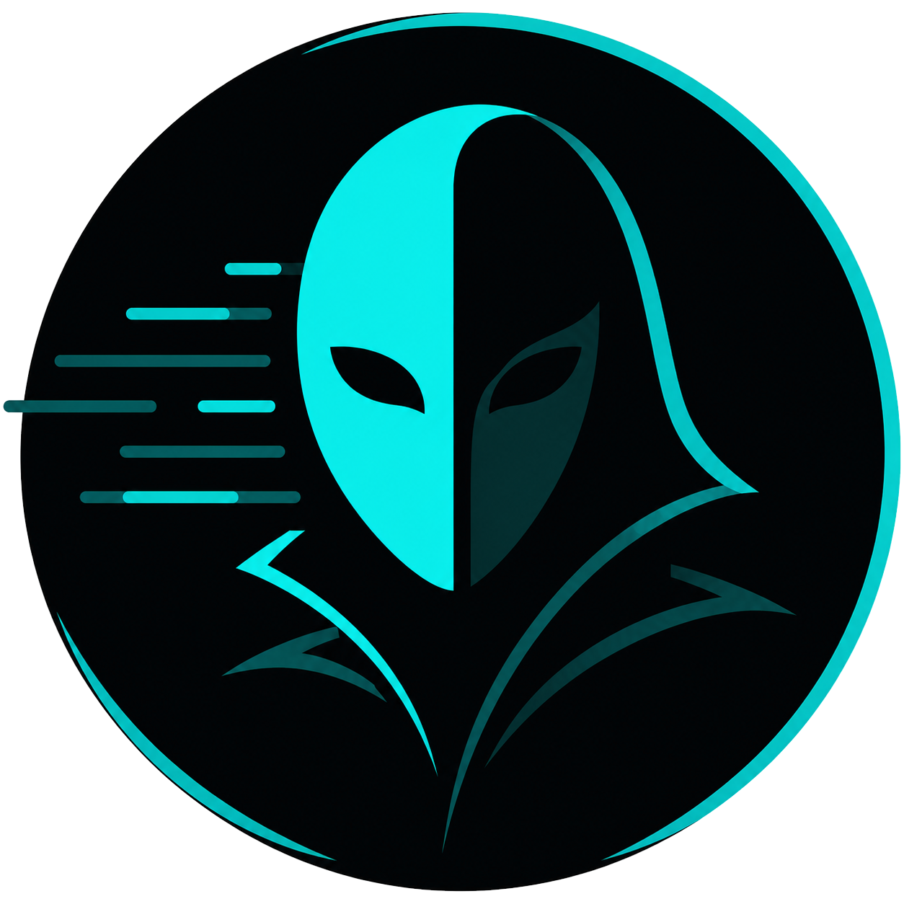

<div align="center">



# UnderStudy

**Human-like game idling for [ArchiSteamFarm](https://github.com/JustArchiNET/ArchiSteamFarm)**

[](https://github.com/Abbadon999/UnderStudy/actions/workflows/build.yml)
[](https://github.com/Abbadon999/UnderStudy/releases/latest)
[](https://github.com/Abbadon999/UnderStudy/releases)
[](LICENSE)


</div>

---

An ArchiSteamFarm plugin that replaces the usual 24/7 single-game idle with a **human-plausible
play pattern**: the bot rotates through the account's library in sessions of random length with
breaks in between, "binges" on a favorite game, revisits old games it already finished, and unlocks
achievements at a believable pace and in a believable order.

```text
[UnderStudy] Playing Graveyard Keeper (599140) for 84 min (cap remaining ~876 min).
[UnderStudy] Trying achievement #12 in Graveyard Keeper (5/18 toward personal target).
[UnderStudy] Session ended — taking a 14 min break.
[UnderStudy] Got bored of Graveyard Keeper (599140) — looking for a new favorite.
[UnderStudy] New favorite: House Flipper (613100).
[UnderStudy] Revisiting PUBG: BATTLEGROUNDS (578080) for old times' sake.
```

## What it does

- **Sessions & breaks** — plays one game at a time for a random stretch (length skewed toward short
  sessions with occasional marathons), then goes online-idle for a few minutes before the next one.
- **Per-game lifetime caps** — each game is played roughly as long as real players play it: the cap
  is derived from the median `playtime_forever` of ~100 recent Steam review authors
  (`store.steampowered.com/appreviews`), with a per-game random jitter. Games with no data fall back
  to a configurable default.
- **Favorites** — the bot gets "into" one game and keeps coming back to it (`FavoriteBias`) until it
  gets bored (`FavoriteSwitchChance`) or exhausts the cap, then adopts a new favorite.
- **Reunions** — occasionally replays a game that already reached its cap, like a human revisiting
  an old title (`ReunionChance`).
- **Human-like achievements** (requires [ASFAchievementManager](https://github.com/CatPoweredPlugins/ASFAchievementManager)) —
  unlocks happen mid-session at a random minute, most sessions produce zero or one. Each game rolls
  a personal completion target once (e.g. 25–75%, with a chance the bot "doesn't care" about a
  game's achievements at all). Candidates are ordered by global unlock percentage (common first),
  "finish the game"-style achievements are held back until ~85% of the playtime cap, and the k-th
  achievement can't drop before roughly k/target of the cap has been played.
- **Server-side achievement detection** — an unlock that doesn't stick is marked protected and never
  retried; after a few failures in one game (`GiveUpAfterFailed`, default 3) the whole game's
  achievements are written off (typical for MMOs with server-side stats).
- **Plays nice with the account owner** — when the user logs into a game on their own machine, the
  plugin stands by and resumes automatically afterwards. Optionally yields to ASF card farming.
- **Fallback** — once every game reached its cap: keep idling a single game (`IdleSingle`), start
  another pass with raised caps (`SecondPass`), idle online (`Idle`), or stop (`Stop`). New games
  (e.g. added by [FreePackages](https://github.com/Citrinate/FreePackages)) are picked up on the
  hourly recheck.

## Configuration

Add a `UnderStudy` block to `config/<Bot>.json` (and remove `GamesPlayedWhileIdle`):

```jsonc
"UnderStudy": {
  "Enabled": true,
  "MinSessionMinutes": 25,
  "MaxSessionMinutes": 180,
  "MinGapMinutes": 3,
  "MaxGapMinutes": 20,
  "PlaytimeFactor": 1.0,        // multiplier over other players' median playtime
  "DefaultCapMinutes": 120,     // cap when review data is unavailable
  "FavoriteBias": 0.7,          // chance a session continues the favorite game
  "FavoriteSwitchChance": 0.08, // chance per session to get bored of it
  "ReunionChance": 0.10,        // chance to revisit a finished game
  "FallbackMode": "IdleSingle", // Idle | IdleSingle | SecondPass | Stop
  "FallbackAppID": 730,
  "Achievements": {
    "Enabled": true,
    "MinTargetPercent": 25,
    "MaxTargetPercent": 75,
    "SkipGameChance": 0.15,     // chance a game gets no achievements at all
    "MaxPerSession": 2,
    "GiveUpAfterFailed": 3,     // failures before writing off a game's achievements
    "EndgameProgressThreshold": 0.85, // "finish the game" achievements wait until this much of the cap is spent
    "SkipFrontRunnerChance": 0.15     // chance to skip the most common candidate for the next one down
  }
}
```

Optional realism knobs: `ActiveHoursStart`/`ActiveHoursEnd` (local hours; outside the window the bot
is online but not playing) and `MaxDailyHours`. `IncludeAppIDs`/`BlacklistAppIDs` scope the library.

State is persisted per bot in `config/<Bot>_UnderStudy.db` (JSON; the `.db` extension keeps ASF from
mistaking it for a bot config).

## Commands

| Command | Effect |
|---|---|
| `understudy status [bot]` | Current phase, game, favorite, cap progress |
| `understudy list [bot]` | Remaining queue with hours left per game |
| `understudy pause [bot]` / `resume [bot]` | Pause/resume the rotation |
| `understudy next [bot]` | Skip to the next session immediately |
| `understudy reset [bot]` | Forget caps/targets and rescan the library |
| `understudy achnow [bot]` | Diagnostic: fire one achievement unlock now |

## Installation

1. Grab `UnderStudy.zip` from the [latest release](../../releases/latest) and unpack it into
   `plugins/UnderStudy/` inside your ASF directory (so the DLL ends up at
   `plugins/UnderStudy/UnderStudy.dll`).
2. Install [ASFAchievementManager](https://github.com/CatPoweredPlugins/ASFAchievementManager) too
   if you want the achievements feature.
3. Add the `UnderStudy` config block (below) to your bot's config and restart ASF.

Built against ASF's `generic` variant; a plugin compiled for one ASF release generally keeps working
until ASF bumps its plugin API, so prefer matching major versions.

## Building from source

1. Download an **ASF-generic** release matching your server's ASF version and unpack it into
   `lib/` (the build references `ArchiSteamFarm.dll`, `SteamKit2.dll`,
   `System.Composition.AttributedModel.dll` from there).
2. `dotnet build -c Release UnderStudy` → copy
   `bin/Release/net10.0/UnderStudy.dll` to `plugins/UnderStudy/` on the ASF host and restart ASF.

> Deploy tip: replace the DLL **atomically** (upload elsewhere, then `mv` over) — overwriting the
> file while ASF runs can crash the JIT mid-read.

## The trimmed-runtime minefield

ASF ships a self-contained, IL-trimmed build: methods that compile fine locally can throw at runtime
if the trimmer decided nothing in ASF's own code paths needed them. Rules this codebase works around:

- **JSON goes through `ArchiSteamFarm.Helpers.Json.JsonUtilities`**, not a bare
  `System.Text.Json.JsonSerializer` call. This isn't a style choice: .NET disables
  `JsonSerializer`'s implicit reflection fallback in trimmed apps, so a plain
  `JsonSerializer.Deserialize<T>()` throws `InvalidOperationException` ("Reflection-based
  serialization has been disabled for this application"). `JsonUtilities` supplies its own
  `TypeInfoResolver`, which is specifically what re-enables it — the extension methods
  (`ToJsonObject<T>()`, `ToJsonText()`) work for arbitrary plugin-defined types, confirmed by
  round-tripping a type ASF has never seen against the actual deployed binary.
- Numeric fields that must survive a restart (`GameEntry.Jitter`, `BotState.PlayedTodayMinutes`) are
  persisted as scaled integers rather than raw `double`s. Doubles do round-trip fine through
  `JsonUtilities` now — this is a deliberate compatibility choice (state files written by earlier
  versions stay readable), not a forced workaround.
- No LINQ selectors (`Min(x => …)`, `Count(pred)`), no `HttpClient.GetAsync` (use
  `ASF.WebBrowser.UrlGetToBinary`), no synchronous `File.ReadAllText`/`File.WriteAllText` — only the
  `Async` overloads are confirmed referenced by ASF's own code, so only those are trusted; state I/O
  blocks on them instead. No `SemaphoreSlim.WaitAsync(TimeSpan)` (the `int` overload survives).
- Not every workaround here has the same evidence behind it. `string.IndexOf(string, int,
  StringComparison)`/`Contains` are confirmed referenced, so `GlobalStatsClient`'s HTML scraping uses
  them directly. `List<T>.Sort()` has no reference either way in ASF's own IL — inconclusive, not
  proof of danger — so `SteamReviewsClient.Median` still sorts by hand; the list involved is capped
  at ~100 items, so the O(n²) cost is not a real concern either way.

`Reflect/` lists which BCL members a given assembly's IL actually references — evidence for "does the
trimmer keep this", not a guess:

```
dotnet run --project Reflect -- [path/to/Assembly.dll] [optional filter substring]
```

That's how the two rules above were confirmed: ASF's own `ArchiSteamFarm.dll` references
`File.ReadAllTextAsync`/`WriteAllTextAsync`, never the synchronous overloads. Absence in this output
isn't proof a member is gone (another assembly in the trimmed closure might still reference it) —
presence is proof it survives.

## Disclaimer

For use on your own accounts, at your own risk. Idling playtime and unlocking achievements you did
not earn may violate Steam's terms; the "human-like" behavior here is about plausibility, not
guarantees.
